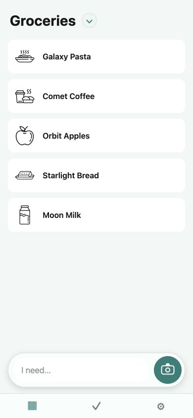
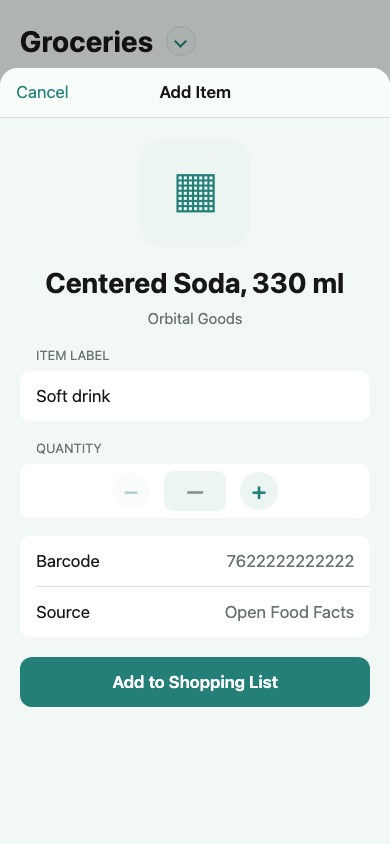
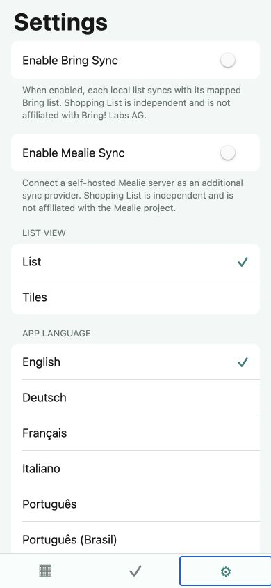
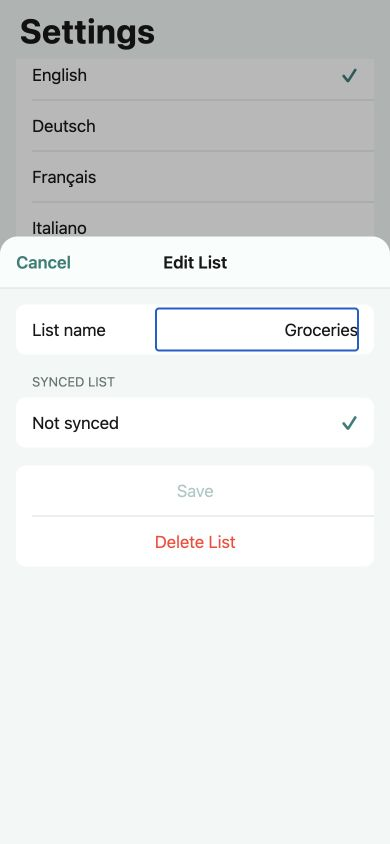
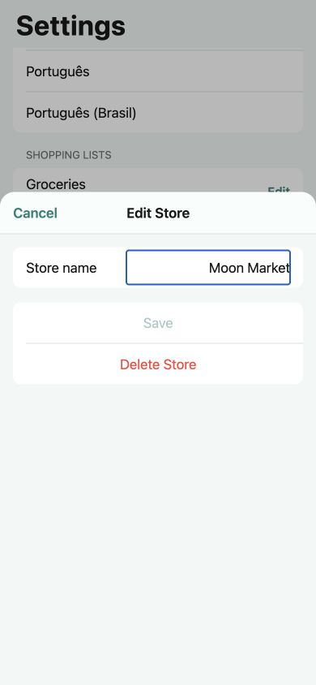

# Shopping List

> [!IMPORTANT]
> **This entire repository, including the application, design, tests, documentation, and deployment setup was made with AI.**

A local-first Expo and React Native shopping companion for iPhone and Android. Add items manually
or scan EAN/UPC barcodes, enrich products from community databases, organize multiple lists, and
take selected lists into a store-specific shopping session. Optional Bring and Mealie adapters keep
individual local lists synchronized without making either provider a requirement.

## Screenshots

<table>
  <tr>
    <td align="center"><br><sub>Local shopping list with grocery icons and floating item composer</sub></td>
    <td align="center"><br><sub>Review and customize a camera-scanned product before adding it</sub></td>
    <td align="center"><br><sub>Independent Bring and Mealie sync settings</sub></td>
  </tr>
  <tr>
    <td align="center"><br><sub>Edit a list and its optional provider mapping</sub></td>
    <td align="center"><br><sub>Edit stores in a keyboard-aware drawer</sub></td>
  </tr>
</table>

## Features

- Manual item entry and EAN-8, EAN-13, UPC-A, and UPC-E scanning with the device camera
- Free food, household, beauty, and pet-product lookup through the Open Facts product family
- Automatic or selected product language with localized-name fallback
- Generic, exact, or ask-every-time item labels
- Custom barcode-to-label mappings that override online results
- Multiple persistent local shopping lists with list and three-column tile layouts
- Product details with barcode, image, source, added time, and store information when available
- Store management and multi-list shopping sessions with reversible purchases and history
- Swipe-to-delete shopping-history entries
- Independent provider and remote-list mapping for every local shopping list
- Multilingual grocery-icon fallback for items without a product image
- Bring synchronization with cross-device barcode metadata enrichment
- Mealie synchronization with shopping-item quantities and units
- Multiple adapters can be enabled simultaneously; each local list maps to at most one provider
- Pull-to-refresh synchronization for mapped lists
- Platform secure storage for provider credentials and API tokens
- Editable item labels and optional quantities before scanned products are added
- English, German, French, Italian, Portuguese, and Brazilian Portuguese interfaces

## Sync adapter architecture

The list UI and synchronization service use the provider-neutral `ShoppingListSyncAdapter`
contract. An adapter supplies provider status plus load, add, restore, and remove operations using
generic remote-list and remote-item identifiers. Provider credentials, API payloads, and item IDs
stay inside their respective adapters.

Bring and Mealie implement this contract independently and can be connected at the same time. A
local list stores one optional sync target containing the provider, remote list ID, and display
name. To add another backend, implement the same contract, register the adapter, and expose its
connection and list-mapping controls in Settings. Scanner, local persistence, reconciliation,
metadata enrichment, shopping sessions, and pull-to-refresh remain provider-neutral.

## Run locally

Requirements: Node.js 22 and npm. Building for iOS also requires Xcode; building for Android
locally requires JDK 17 and Android SDK 36. A physical device is needed for camera scanning.

```sh
npm ci
npm run ios
```

Before running the app, create an ignored `.env` file:

```sh
cp .env.example .env
```

Set `EXPO_PUBLIC_BRING_API_KEY` in that file if Bring support is required. Expo public environment
variables are embedded in the compiled app, so this keeps the value out of Git but does not make a
mobile client key cryptographically secret. Mealie is configured at runtime with a server URL and
API token in Settings.

Useful device shortcuts:

```sh
npm run ios:device   # Debug build on a connected iPhone
npm run ios:release  # Standalone Release build on a connected iPhone
npm run android:device    # Debug build on a connected Android device
npm run build:android:apk # Standalone Android APK
npm run dev:tunnel        # Metro dev server reachable through an Expo tunnel
```

`ios:device` opens Expo's eligible-device picker. To target a device directly without the picker, pass its name locally:

```sh
npm run ios:device -- "Your iPhone Name"
```

Do not commit a personal device name or UDID to the repository.

## Android CI artifact

After the quality, build, unit, integration, browser, and coverage jobs pass on `main`, Gitea builds
a standalone Android APK and keeps it as a workflow artifact for 30 days. Configure the
`EXPO_PUBLIC_BRING_API_KEY` repository secret before running the job. The workflow generates the
native Android project with Expo Prebuild, so it does not use EAS or require an Expo account.

The artifact is named `shopping-list-android-preview-<commit>` and can be sideloaded on an Android
device. It is a preview build signed with Expo's generated debug identity, not a production signing
identity for an app store. A future store release needs a private, backed-up Android keystore.

Run verification with:

```sh
npm run format:check
npm run lint
npm run typecheck
npm test
npm run test:integration
npm run test:coverage
npm run build
npm run test:e2e:local
```

`npm test` runs isolated unit tests. `npm run test:integration` runs the rendered React Native and
service flows that previously lived under the misleading E2E name. `npm run test:e2e` runs genuine
Playwright browser tests against the already exported Expo web bundle. To build that bundle and run
the browser suite in one command, use:

```sh
npm run test:e2e:local
```

The browser suite uses Chromium, a synthetic camera, mocked external services, and enforced
`.example` account data. Its test API and credential adapter only run on a loopback host, so the
bundle cannot send credentials to a live provider. It covers provider connections, persisted
settings, languages, label options, custom barcodes, centered-barcode selection, product lookup
failures, shopping sessions, and synchronization retries. The test-only web export is not uploaded
as a build artifact, is not a deployable version of the native app, and does not replace real-device
checks for camera APIs, platform secure storage, keyboards, or native safe areas.

The coverage command runs the complete unit and integration suite and enforces minimum global
coverage thresholds.

## Bring metadata interoperability

For a scanned item, Shopping List appends a compact `EAN:<barcode>` marker to Bring's item
specification. A quantity and barcode are represented as `2× · EAN:7612345678901`. Other Shopping
List installations can parse this marker and retrieve the product image and brand independently
from the Open Facts product APIs. The visible shopping-list label remains the label stored in Bring.
Manual items do not include a barcode marker.

Automatically format the codebase and apply safe ESLint fixes with:

```sh
npm run fix
```

## Privacy and service notes

See the [Privacy Policy](PRIVACY.md) for a complete description of on-device storage and network
communication.

In the native app, provider credentials and API tokens are stored only in platform secure storage
and are never written to source files or regular app storage. Lists, mappings, scanned metadata,
custom barcode labels, stores, and shopping history remain in local app storage. The test-only
browser build uses isolated fantasy data and mocked provider services.

Shopping List is an independent project and is not affiliated with Bring! Labs AG or the Mealie
project.

Product information comes from these community-contributed Open Facts databases:

- [Open Food Facts](https://world.openfoodfacts.org/) for food and drinks
- [Open Products Facts](https://world.openproductsfacts.org/) for household goods and other non-food products
- [Open Beauty Facts](https://world.openbeautyfacts.org/) for cosmetics, hygiene, and personal-care products
- [Open Pet Food Facts](https://world.openpetfoodfacts.org/) for pet food and treats

Their data is available under the Open Database License. Coverage and labels vary by country and contributor data.

Food, beverage, and utensil artwork is from [Food Icon Pack](https://foodiconpack.com/) and is
licensed under [CC BY 4.0](https://creativecommons.org/licenses/by/4.0/). The app bundles a curated
subset of the Common Ingredient Icons, Common Utensils, Common Beverages, and Common Dishes packs.

## License

MIT — see [LICENSE](LICENSE).
