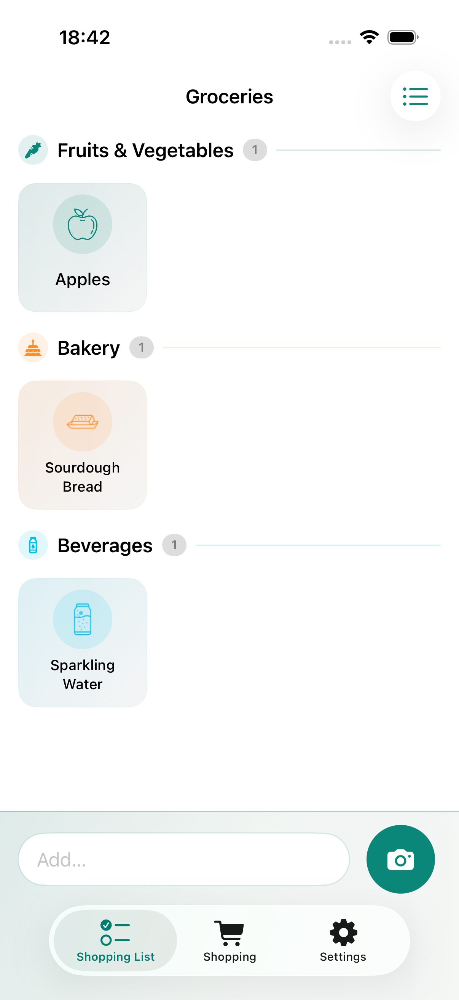
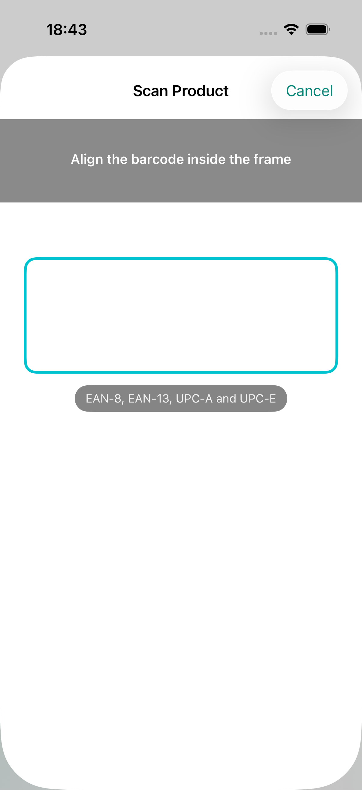
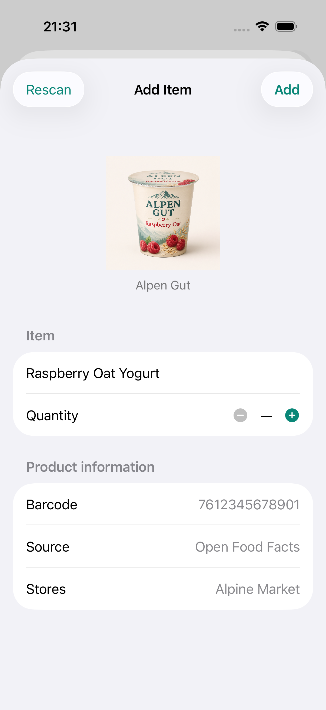
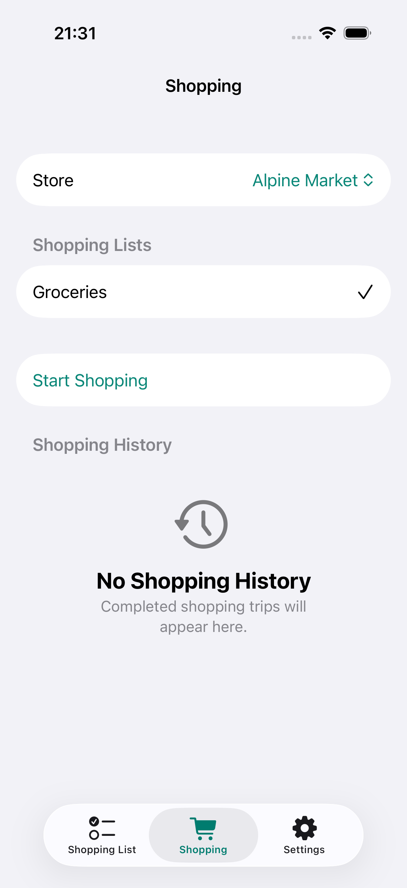
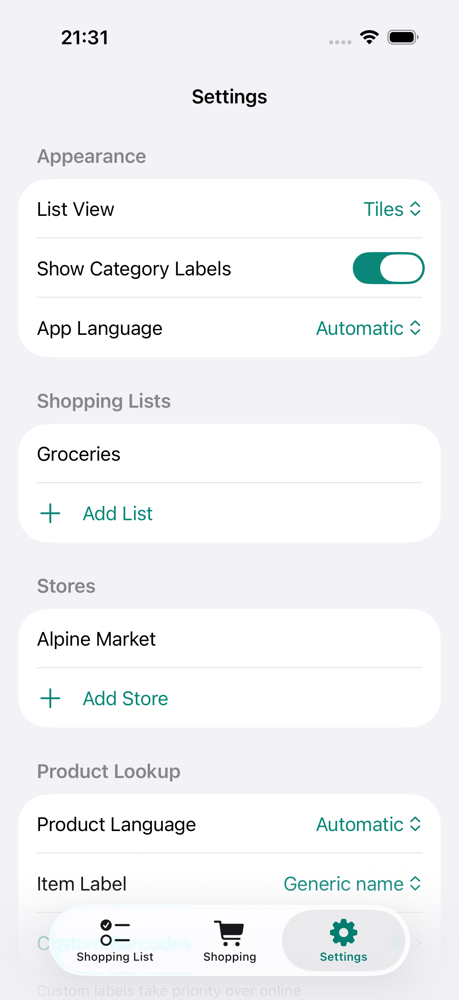

# Shopping List

> [!IMPORTANT]
> **This entire repository, including the application, design, tests, documentation, and deployment setup was made with AI.**

Shopping List is a private, iPhone-only companion for planning groceries, scanning products, and
keeping a useful record of each shop. It is written entirely in Swift 6 and SwiftUI. All lists,
product metadata, stores, and shopping history are available locally; optional provider adapters
can synchronize individual lists without changing the core app.

## Screenshots

| Shopping list | Barcode scanner |
| --- | --- |
|  |  |
|  | |
| **Shopping** | **Settings** |
|  |  |

## Features

- Native SwiftUI navigation, tab bar, forms, sheets, menus, list rows, and square tile layouts
- Multiple shopping lists, a polished list switcher, and list or tile display preferences
- Fast manual entry plus AVFoundation EAN-8, EAN-13, UPC-A, and UPC-E barcode scanning
- Multilingual grocery categorization with typo-tolerant matching, category colours, and optional
  category headings
- Product images and grocery icons, with a locally cached initial-letter fallback when neither is
  available
- Cached barcode metadata from Open Food Facts and related product databases, including brand,
  quantity, stores, source, and product type
- Custom barcode labels and configurable product language and label style
- Store management, multi-list shopping sessions, reversible purchases, and deletable history
- Pull-to-refresh synchronization through provider-neutral adapters for Bring, Mealie, and the
  self-hosted [Shopping List Server](https://git.benn0r.cloud/benn0r/shopping-list-server); all can
  be enabled together, while each local list maps to at most one provider list
- Shopping List Server sync uses its URL and an API key from its web interface (Settings → API
  Tokens); the icon and category the server returns for an item replace the app's own label
  matching, and icons the server generated are downloaded once and cached
- Local JSON persistence with no React Native, Expo, JavaScript runtime, CocoaPods, or Android
  target

## Requirements

- macOS with Xcode 26 or newer
- Node.js 22 and npm (command runner only; there are no npm dependencies)
- [XcodeGen](https://github.com/yonaskolb/XcodeGen): `brew install xcodegen`
- [Maestro](https://maestro.mobile.dev/) for E2E tests: `brew install maestro`

## Commands

Copy `.env.example` to the ignored `.env` file and set `IOS_DEVELOPMENT_TEAM` to your Apple
Developer Team ID. Project generation then applies automatic signing every time, so regenerating
`ShoppingList.xcodeproj` does not lose the selected team.
Set `BRING_API_KEY` in the same file when using Bring synchronization. The value is embedded into
the app at build time; the previous `EXPO_PUBLIC_BRING_API_KEY` name is accepted for migration.

```sh
npm run ios          # Generate and open the Xcode project
npm test             # Run XCTest with code coverage on an iPhone simulator
npm run test:e2e     # Build once, start mock providers, and run every Maestro journey
npm run build        # Unsigned native Release build
npm run ios:release  # Signed Release build using local Xcode signing settings
npm run deploy       # Install Release app; requires IOS_DEVICE_ID
```

The generated `ShoppingList.xcodeproj` is derived from the tracked `project.yml`. Change project
settings in that file and regenerate instead of editing the project manually.

## Testing

The XCTest suite covers persistence, item/list/store/custom-barcode CRUD, categorization and typo
matching, barcode metadata precedence and caching, provider synchronization, error handling,
multi-list shopping, reversible purchases, and shopping-history lifecycle behavior. Code coverage
is enabled for every unit-test run.

Maestro drives the compiled app on an iPhone simulator. Its journeys cover every tab and primary
view, manual entry, scanner presentation, item details and removal, list/tile appearance, category
visibility, app and product languages, label preferences, custom barcodes, list/store editors,
provider configuration and mapping, multi-list shopping, purchase restoration, completion, and
history deletion. Display-affecting preferences are verified after navigating back to the affected
tab instead of merely checking their settings controls.

## Mock provider tests

`npm run mock:providers` starts a dependency-free local server on port 8787. It implements the
Bring authentication/list/item endpoints, Mealie shopping-list/item endpoints, and the Shopping
List Server `/api/v1` list/item endpoints (API key `slt_mock`) used by the app.
Maestro starts this server automatically, so E2E tests never contact live provider accounts.

The mock data is fictional. Provider URLs and credentials are entered at runtime and must never be
committed. Shopping List is independent and is not affiliated with Bring! Labs AG or the Mealie
project.

## Architecture

- `ShoppingListApp/Models.swift`: provider-neutral persisted data
- `ShoppingListApp/AppStore.swift`: local storage and shopping workflows
- `ShoppingListApp/Providers.swift`: Bring/Mealie adapters
- `ShoppingListApp/*Screen.swift`: native SwiftUI interface
- `ShoppingListTests/`: XCTest unit tests
- `maestro/`: simulator E2E flows
- `mocks/`: deterministic local provider API

See [PRIVACY.md](PRIVACY.md) for privacy details.

## License

MIT — see [LICENSE](LICENSE).
